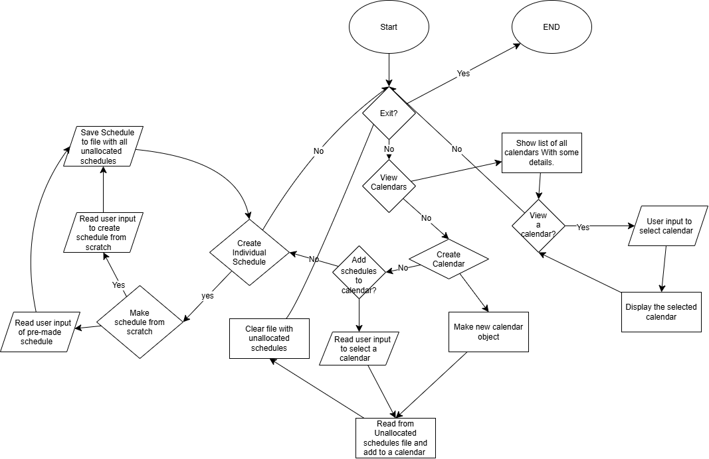

# Project Name

One-sentence description of what it does.

## The Problem
Trying to find dates and times that a large group of people will be available on.

## How It Works

A paragraph or a few bullets explaining what the software does at a
high level. If you have a diagram, embed it here:



## Tech Stack

- **Language:** Java
- **Libraries:** ArrayLists, Math, time
- **External tools:** IntelliJ

## Setup

Step-by-step: how does someone who just cloned your repo get it
running?

```bash
git clone https://github.com/gjhainzl/cs193-final-project
cd your-project
./install.sh   # or whatever
```

## Usage

How to actually run the thing, with examples.

```bash
./backup.sh ~/Documents
```

## Roadmap

Features you haven't built yet but plan to (pull these from your
"Schedule" quadrant in the Eisenhower Matrix).

- [ ] Desktop notifications
- [ ] Multi-directory support

## Author

Gabe Hainzl, github.com/gjhainzl